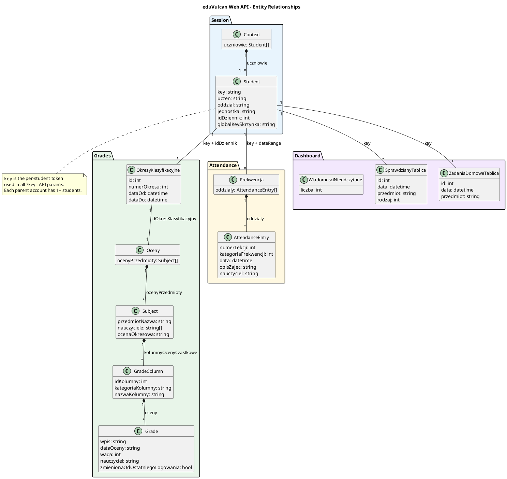

# eduVulcan web API reference

Reverse-engineered from the `uczen.eduvulcan.pl` SPA (March 2026).

The [machine-readable OpenAPI contract and on-demand gathering/checking jobs](eduvulcan/README.md)
record current structural evidence and verification gaps. This document remains
the historical explanatory reference; its examples alone do not prove live compatibility.

## Authentication

The web API uses ASP.NET session cookies. No JWTs involved - the auth flow is WS-Federation (SAML XML tokens) between three domains:

1. `eduvulcan.pl` - main portal, handles login
2. `dziennik-logowanie.vulcan.net.pl/{tenant}` - federation service, issues security tokens
3. `uczen.eduvulcan.pl/{tenant}` - student dashboard, consumes tokens and sets session cookies

Key cookies for API access:
- `ASP.NET_SessionId` (on `uczen.eduvulcan.pl`)
- `Eduvulcan.Uczen.Sso` + `Eduvulcan.Uczen.Sso1` (XML security context tokens, split across two cookies)
- `X-V-RequestVerificationToken#...` (CSRF-like token)

The `tenant` is the school district identifier extracted from the dashboard URL (e.g. `exampledistrict`).

Exported cookies are filtered by host-only/domain scope, path boundaries, expiry
and Secure metadata. Applicable same-name cookies retain browser path order.
Authentication verifies HTTP `/api/Context` access before replacing the session;
a successful student-page navigation alone does not prove the HTTP worker can
use the exported state. API requests refuse redirects with manual cookie headers.

**Important:** the iris library's `register_by_jwt` endpoint expects JWTs, but eduVulcan no longer provides them through the web login flow. This project uses saved browser cookies instead.

## Base URL

```
https://uczen.eduvulcan.pl/{tenant}/api/
```

## Student context

### GET /api/Context

Returns all students linked to the logged-in parent account.

On 2026-10-11 a deployment reported HTTP 400 during session validation, persisting
after manual authentication while browser school data loaded normally. The exact
server rejection reason is unverified. A local regression reproduced a client
cookie-selection defect: an unrelated tenant/path's same-name cookie overwrote
the applicable cookie. Cookie scoping and authentication finalization are now
tested locally; resolution of this live deployment has not yet been verified.
400 remains a validation error, with safe response-kind, redirect-count and
cookie-size diagnostics; it is not automatically treated as session expiry.

A deployment log on 2026-10-04 showed this endpoint returning HTTP 409 for a
saved session. The response body and the server's exact conflict semantics were
not captured. The application treats this Context conflict as eligible for session
recovery, first through persistent Chromium, with the existing bounded mid-sync
retry. This policy applies to student Context only; it does not assert that all
409 responses mean authentication expiry. Successful live recovery from this
specific conflict has not yet been verified.

```json
{
  "uczniowie": [
    {
      "key": "BASE64_ENCODED_STUDENT_KEY",
      "uczen": "Jan Kowalski",
      "oddzial": "3A",
      "jednostka": "Szkola Podstawowa nr 1",
      "idDziennik": 1001,
      "idJednostkaSkladowa": 1,
      "globalKeySkrzynka": "aaaaaaaa-bbbb-cccc-dddd-eeeeeeeeeeee",
      "aktywny": true,
      "opiekunUcznia": true
    }
  ]
}
```

The `key` field is the per-student token used as `?key=` parameter in all subsequent API calls. Each parent account can have multiple students.

## Grades

### GET /api/OkresyKlasyfikacyjne?key={key}&idDziennik={idDziennik}

Returns classification periods (semesters). Required before fetching grades.

```json
[
  {"id": 1001, "numerOkresu": 1, "dataOd": "2025-09-01T...", "dataDo": "2026-01-31T..."},
  {"id": 1002, "numerOkresu": 2, "dataOd": "2026-02-01T...", "dataDo": "2026-08-31T..."}
]
```

### GET /api/Oceny?key={key}&idOkresKlasyfikacyjny={periodId}

Returns all grades for a student in a given period. Grouped by subject.

```json
{
  "ocenyPrzedmioty": [
    {
      "przedmiotNazwa": "Edukacja wczesnoszkolna",
      "pozycja": 1,
      "nauczyciele": ["Nowak Anna [AN]"],
      "srednia": null,
      "ocenaOkresowa": " ",
      "proponowanaOcenaOkresowa": " ",
      "kolumnyOcenyCzastkowe": [
        {
          "idKolumny": 100001,
          "kategoriaKolumny": "Biezace",
          "nazwaKolumny": "Sprawdzian 1",
          "oceny": [
            {
              "wpis": "5p",
              "dataOceny": "26.01.2026",
              "waga": 1,
              "kolorOceny": 0,
              "nauczyciel": "Nowak Anna [AN]",
              "zmienionaOdOstatniegoLogowania": false,
              "idOcenaPoprawiona": null
            }
          ]
        }
      ]
    }
  ]
}
```

Grade structure: `Oceny -> Subject -> GradeColumn -> Grade`. The `zmienionaOdOstatniegoLogowania` flag indicates whether a grade changed since the last login - useful for change detection.

## Attendance

### GET /api/Frekwencja?key={key}&dataOd={isoDate}&dataDo={isoDate}

Returns attendance records for a date range. Dates are ISO 8601 with timezone offset.

```json
{
  "oddzialy": [
    {
      "idPoraLekcji": 37,
      "numerLekcji": 5,
      "kategoriaFrekwencji": 1,
      "data": "2026-03-09T00:00:00+01:00",
      "opisZajec": "Przyroda",
      "nauczyciel": "Wisniewski Tomasz",
      "godzinaOd": "2026-03-09T11:45:00+01:00",
      "godzinaDo": "2026-03-09T12:30:00+01:00"
    }
  ]
}
```

The response also contains `dziennikiZajecInnych` (other activities) and
`dziennikiSwietlicy` (childcare). Synchronization reads all three collections.
Classroom identity remains `(date, lesson_number)`; unnumbered activities also
use source and the `(time_from, time_to, subject)` tuple. Separate source identities
prevent overwrites between collections. `last_sync:<student>:attendance_full`
baselines the additional collections silently on upgrades, preserving classroom
change detection. The October 11, 2026 live audit returned 101 classroom records
and 2 other-activity records; the previous parser dropped the latter.

`kategoriaFrekwencji` persists as a numeric upstream ID. A live check on
October 12, 2026 matched the `/frekwencja` legend (labels, symbols and CSS classes)
with the numeric enum in the portal's JavaScript. These are the verified mappings:

| Code | Description | Legend symbol |
| --- | --- | --- |
| 1 | Obecność | O |
| 2 | Nieobecność | N |
| 3 | Nieobecność usprawiedliwiona | NU |
| 4 | Spóźnienie | S |
| 5 | Spóźnienie usprawiedliwione | SU |
| 6 | Nieobecność z przyczyn szkolnych | NS |
| 7 | Zwolnienie | Z |

The live response included code 6 and its rendered icon used the
`nieobecnyZPrzyczynSzkolnych` class. The earlier application mapping incorrectly
swapped 3/4, labeled 6 as exemption and omitted 7. The shared presentation formatter
now follows the verified enum, with a Polish description followed by `(code)`.
MQTT also corrects `category` assignment to `3=excused`, `4=late`; its generic
`category_N` values for other codes remain compatible. Unmapped IDs remain explicit
without guessed meanings. Original SQLite numbers are unchanged.
`tests/fixtures/attendance_categories.json` retains only public labels, symbols,
CSS classes and enum names; no student/profile/attendance/session data.
The legend's UW/UZ/UO symbols describe excuse-request approval states, separate
from these seven attendance categories.

### GET /api/FrekwencjaStatystyki?key={key}&idPrzedmiot={id}

Attendance statistics. Use `idPrzedmiot=-1` for all subjects.

### GET /api/Usprawiedliwienia?key={key}&dataOd={isoDate}&dataDo={isoDate}

Excuse requests for the given date range.

## Dashboard summaries (Tablica endpoints)

These lightweight endpoints provide dashboard summaries and can omit historical
or otherwise hidden records. Use module endpoints as the synchronization source;
dashboard responses do not establish completeness or cancellation.

### GET /api/OcenyTablica?key={key}

Recent grade changes. Returns `[]` when no recent changes.

### GET /api/FrekwencjaTablica?key={key}

Recent attendance changes.

```json
{
  "oddzialy": [...],
  "dziennikiZajecInnych": []
}
```

### GET /api/SprawdzianyTablica?key={key}

Upcoming exams/tests.

```json
[
  {"id": 10001, "data": "2026-03-16T...", "przedmiot": "Przyroda", "rodzaj": 2}
]
```

`rodzaj`: 1 = test (sprawdzian), 2 = quiz (kartkowka) - needs verification.

### GET /api/SprawdzianSzczegoly?key={key}&id={examId}

Exam detail. Returns description and teacher.

```json
{
  "typ": 2,
  "data": "2026-03-23T00:00:00+01:00",
  "przedmiotNazwa": "Język polski",
  "nauczycielImieNazwisko": "Agnieszka Kochanowska-Sabljak",
  "opis": "Test ze znajomości lektury \"Mikołajek\".",
  "id": 43431
}
```

### GET /api/ZadaniaDomoweTablica?key={key}

Upcoming homework.

```json
[
  {"id": 10002, "data": "2026-03-16T...", "przedmiot": "Plastyka"}
]
```

### GET /api/ZadanieDomoweSzczegoly?key={key}&id={homeworkId}

Homework detail. Returns description, teacher, attachments, and student response status.

Synchronization enriches `Homework` before detecting new-ID changes using `opis`,
`nauczycielImieNazwisko`, `linki`, `odpowiedzWymagana` and `terminOdpowiedzi`.
Email and MQTT notifications include these available details. `linki` is retained
as raw JSON; populated item shapes are not confirmed by the recorded empty array.
The database automatically adds these fields and a successful-detail timestamp;
all returned tasks refresh their details on every sync, silently for known IDs. Empty
descriptions count as fetched; successful responses replace cleared/null fields,
while failed reads retain stored details and retry on the next sync. The entire
detail response is
stored as `details` JSON and exposed through MQTT and the local homework API.
Notifications also include available attachment labels/links, response text and
teacher comments. Populated attachment item shapes and numeric status meanings
remain unverified; no status labels are inferred.

```json
{
  "typ": 4,
  "data": "2026-03-16T00:00:00+01:00",
  "terminOdpowiedzi": "2026-03-16T00:00:00+01:00",
  "przedmiotNazwa": "Plastyka",
  "nauczycielImieNazwisko": "Paulina Studnicka",
  "opis": "Na plastykę proszę przynieść blok rysunkowy...",
  "zalaczniki": [],
  "linki": [],
  "status": 0,
  "odpowiedzWymagana": false,
  "zadanieModulDydaktyczny": false,
  "odpowiedz": {
    "id": 642123,
    "status": 1,
    "odpowiedz": null,
    "komentarzNauczyciela": null,
    "zalaczniki": [],
    "data": null
  },
  "id": 36511
}
```

### GET /api/SprawdzianyZadaniaDomowe?key={key}&dataOd={from}&dataDo={to}

Calendar view combining both exams and homework. Used by the "Sprawdziany i zadania domowe" page.

Homework synchronization uses this endpoint with configurable full local-day
lookback/lookahead (`SYNC_HOMEWORK_DAYS=365`, `SYNC_HOMEWORK_FUTURE_DAYS=365`),
serialized as UTC. A live session check confirmed a homework entry dated October
9, 2026 here while `/api/ZadaniaDomoweTablica` returned an empty list. The observed
homework list item shape is:

```json
{"typ": 4, "przedmiotNazwa": "Example subject", "data": "2026-10-09T00:00:00+02:00", "hasAttachment": false, "id": 1}
```

This example uses a synthetic ID/subject. `typ=4` identifies homework; all other
numeric type codes are retained as exams without guessing additional enum meanings.
Exam synchronization uses this same calendar with `SYNC_EXAM_DAYS=365` and
`SYNC_EXAM_FUTURE_DAYS=365`. Exam descriptions and teachers are fetched before
creating new change events, including a teacher paired with an empty description.
Full detail JSON persists in `exams.details` and is exposed through HTTP/MQTT.
Known exams refresh details silently. `last_sync:<student>:exams_calendar`
initializes expanded history silently on upgrades; subsequent unseen IDs notify.
Missing exams are retired only within the successfully fetched date window,
including successful empty lists; rolled-out history remains stored.
Invalid/malformed calendar items fail the section instead of being interpreted as an empty list. The initial
calendar-source read baselines expanded history silently, independently of the
existing dashboard-source marker; later unknown IDs notify. Missing tasks are
soft-deleted only within the successfully fetched window. The dashboard overview
still uses the original upcoming-only endpoint.

### GET /api/WiadomosciNieodczytane

Unread message count (not per-student, account-level).

```json
{"liczbaWiadomosciNieodczytanych": 214}
```

### GET /api/OgloszeniaTablica?key={key}

Announcements. Returns `[]` when none.

### GET /api/UsprawiedliwieniaTablica?key={key}

Excuse overview.

### GET /api/WychowawcyTablica?key={key}

Homeroom teachers.

```json
[{"imieNazwisko": "Kowalczyk Maria", "isGlowny": true, "globalKeySkrzynka": "..."}]
```

### GET /api/Uwagi?key={key}

Student praise and behavior notes. Request needs the authenticated student session
and URL-encoded student `key`; no date-range or pagination parameters were observed.
Returns the available list, or `[]` when none. The recorded schema includes:

```json
[{"id": 1, "data": "2000-01-03T08:00:00+01:00", "kategoria": "SYNTHETIC",
  "typ": 1, "autor": "SYNTHETIC", "tresc": "SYNTHETIC",
  "rodzaj": 1, "liczbaPunktow": null}]
```

`VulcanClient.get_remarks()` returns `Remark` models. Numeric `typ` and `rodzaj`
are retained verbatim: their enum meanings have not been confirmed. Both praise
and notes share this endpoint and the `/App/{encoded student key}/pochwalyUwagi`
view. Content is returned in the list; no detail request is needed.

Synchronization persists rows by `(student_key, id)`, tracks a separate category
baseline, emits new-ID events only and soft-deletes missing entries. See
`docs/email.md` for individual notification behavior. Implementation tests use the
recorded sanitized contract; live fetching/link navigation was not verified during
this implementation.

## Other endpoints

### GET /api/PoryLekcji?key={key}

Lesson time slots for the school.

### GET /api/Przedmioty?key={key}

List of subjects.

### GET /api/DniWolne?key={key}&dataOd={isoDate}&dataDo={isoDate}

School holidays/days off.

### GET /api/PlanZajecTablica?key={key}

Today's schedule. Returns a list of lesson dicts (see `PlanZajec` below for field details). Despite accepting `data=` / `dataOd=` / `dataDo=` query params, it **ignores them** and always returns the current day. Use `PlanZajec` for any range other than today.

### GET /api/PlanZajec?key={key}&dataOd={isoDatetimeUtc}&dataDo={isoDatetimeUtc}&zakresDanych=2

Schedule across a date range — the endpoint used by the web app's "Plan zajęć" week/month view. Includes substitutions (`zastępstwa`).

- `dataOd` / `dataDo`: full ISO-8601 UTC datetimes (e.g. `2026-03-31T22:00:00.000Z`), framing local-time midnight-to-midnight in Europe/Warsaw.
- `zakresDanych=2`: required; the web app always sends 2 for this view.

Response: list of lesson dicts with keys:

- `data` / `godzinaOd` / `godzinaDo` — local-timezone ISO datetimes
- `prowadzacy`, `prowadzacyWspomagajacy1`, `prowadzacyWspomagajacy2` — teacher + up to two assistants
- `przedmiot` — subject name
- `podzial` — group label (e.g. `BS` for pool group), nullable
- `sala` — room
- `pseudonim` — nullable nickname
- `adnotacja` — int flag; non-zero means the lesson has changes/annotations
- `dodatkowe` — bool; extra/added lesson
- `zrealizowane` — bool; lesson already took place
- `idJednostkaSkladowa` — school unit id
- `zmiany` — list of substitution entries (empty when no change):
  - `zmiana` — change type code (e.g. 7 for teacher swap)
  - `typProwadzacego` — teacher-type flag
  - `prowadzacy` — replacement teacher name
  - `sala` — replacement room (may be empty string)
  - `dzien`, `nrLekcji`, `godzinaOd`, `godzinaDo`, `grupa`, `zajecia`, `informacjeNieobecnosc` — nullable overrides for reschedules/absences
- `zmianyUwagi` — list of free-text remarks about the change

### GET /api/RealizacjaZajec13?key={key}&dataOd={from}&dataDo={to}&status={status}

Lesson realization, used by the web `/realizacjaZajec` page. Both tabs use this
endpoint: `status=2` selects **Zaplanowane**, and `status=1` selects **Zrealizowane**.
This is a separate entity from the lesson schedule returned by `PlanZajec`.

The observed response is an array of records with `id`, `data`, `nrLekcji`,
`przedmiot`, `nauczyciel`, `blokTematyczny` and `tematOpis` (topic/description).
Additional fields are `online` (Zajęcia online), `kolekcjePoLekcji` and
`existsKolekcjePoLekcji` (Kolekcje po lekcji), and `zasoby` (Zasoby). Online links
and collections were empty and resources null in the sample; populated shapes
remain unverified. See `docs/eduvulcan/openapi.yaml` for the captured schema.

`VulcanClient.get_completed_lessons()` implements this recorded contract with
`status=1` only. It encodes the student key and date parameters, validates the
entire response before persistence and collapses identical duplicate IDs;
conflicting duplicate IDs fail the section. `CompletedLesson` retains the original
date, lesson number, subject, teacher, topic, thematic block, online link, collection
list, collection flag and resources. Unverified populated collections/resources
are preserved as JSON, without assuming an undocumented nested schema. Each item
links to the authenticated tenant's `/App/{encoded student key}/realizacjaZajec`.
Synchronization requests full local days from `SYNC_COMPLETED_LESSONS_DAYS` days
ago through today (default 90), converted to UTC instants with DST handling.
This implementation was tested against recorded/synthetic responses; live API
behavior was not verified during implementation.

### GET /api/KomunikatStartowy

System-wide announcements. Returns `[]` when none.

## Entity relationships



![eduVulcan Web API Entity Relationships](https://www.plantuml.com/plantuml/svg/fLPBQzj04BxlhrZKMq92JL983QK9iLr2GbpYqa1A3wFTYRsMj2kqArofvBztzFJALauzIPxvvltDoDVMGURo96PEkHWvolnd7WlG_1b3VlFzZf_nkIPTmPym1gUCjXkLMcOZfLF88E4Y1cjldCjKc3ky4qQlL8dyuo5aORIhDPCBJvM2Y62DU-KbsoX9YIGfnKpGROoqZBKm7gpGMaeYu1_cLulBnOp_PRpnps_91_vnjOJpN9HQcPt2AL-vNA9sltwJuetr-5RSuYCifjnI5NhTsQCUI8oKfO9u8DkYrCQw20PI9MUbGgrLDELAkrgsZaq8yJqMgoWh2psmU6DlNedVCf1ecme_pJzx5IwZ36rnJ-_5guf055kDRVfAxaFfFC6inkPxeGG7ImBH4vrAi1VEp43eDMWfK1UjVrEzVyzAb8aoZbgroiCjYkEcDkBMAkqC7g7S3NkaWJfS28KnTlBQLnCAwlJDRjYbFahTebiJvudkwx-lVnRxYYCgQcqo1Rrc49uIEbOSncYzxr9b1-PrDwkM3AGxM8CtXhx20QXCY1f4OPh6ahRFQKLPFfWr5QiLcOV6n4USeFr2BK4B95ui5ekh-SJZnIB3Q8TQRA6RLaDLocvlI6kS5OVZEb2tvZM17Z0IMpNIpZwQ6hBhW5k6UlO2H8Ptnluk_sTWDw61J5QbNj0I-4k-IZFOLSNfuWU4iH8miW0ZsVHC76IJ6Ld2jZFq-l82ifh6p2HcX_yTo7Fyh42IKolKeq8ZgHSE-YMcA6K8-tJ8hZjgmIJW9sTdz3m_FmdwspNTtpdMoIfeXIJOwC6OLhUEdtfNYetYEZ_qQ2u19IPhv01Oi4RRPrYbrrw1wU7TO9t6H_lRJCarIraxlIs1ZYkDWFcO8zikpbWBlDte2g_czGHwZSnJ-auFjsBQBzHOX15Arf76iAEyQj1C6uUq_SwPX9lNRiH4X20WVH1mPRdR84ynExEjQsSYr0J9BKgY3OSuvby9_QN-TjUVM7jE-Zc8JVMpiW4XJ4xF3LW-EUMjAu9HpRnAWbtJ6_qd-0S0)

## Messages (separate subdomain)

Messages live on `wiadomosci.eduvulcan.pl/{tenant}/api/`, not on the main `uczen.eduvulcan.pl` domain. The inbox is unified across all students - the `skrzynka` field on each message indicates which child's mailbox it belongs to.

### GET /api/Skrzynki

Returns mailboxes for all students. The `globalKey` matches `globalKeySkrzynka` from the Context endpoint.

The client fetches this list for a non-empty inbox and resolves each message's
`skrzynka` label against `nazwa`. Only labels with a single distinct `globalKey`
are mapped. `Message.mailbox_key` carries that key in memory for student-specific
email headings, avoiding assumptions about name order or school display names.
Mailbox lookup errors other than session expiry retain message acquisition;
session expiry requests the usual authentication recovery.

```json
[
  {"globalKey": "aaaaaaaa-...", "nazwa": "Parent Name - R - Child Name - (School)", "typUzytkownika": 2},
  {"globalKey": "bbbbbbbb-...", "nazwa": "Parent Name - R - Other Child - (School)", "typUzytkownika": 2}
]
```

### GET /api/LiczbyNieodczytanych

Unread count per mailbox.

```json
[
  {"globalKey": "aaaaaaaa-...", "liczbaWiadomosci": 150},
  {"globalKey": "bbbbbbbb-...", "liczbaWiadomosci": 64}
]
```

### GET /api/Odebrane?idLastWiadomosc={lastId}&pageSize={n}

Received messages, paginated. Use `idLastWiadomosc=0` for the first page.

```json
[
  {
    "id": 379162,
    "apiGlobalKey": "646d3311-...",
    "korespondenci": "Kieca Anna - P - (School)",
    "temat": "Message subject",
    "data": "2026-03-15T11:02:41.183+01:00",
    "skrzynka": "Parent Name - R - Child Name - (School)",
    "hasZalaczniki": false,
    "przeczytana": false,
    "wazna": false,
    "uzytkownikRola": 2,
    "wycofana": false,
    "odpowiedziana": false,
    "przekazana": false
  }
]
```

### GET /api/WiadomoscSzczegoly?apiGlobalKey={uuid}

Full message detail including HTML content.

```json
{
  "id": 379162,
  "apiGlobalKey": "646d3311-...",
  "nadawca": "Kieca Anna - P - (School)",
  "odbiorcy": ["Parent Name - R - Child Name - (School)"],
  "temat": "Message subject",
  "tresc": "<p>HTML message content</p>",
  "data": "2026-03-15T11:02:35+01:00",
  "odczytana": false,
  "zalaczniki": []
}
```

### GET /api/Cache

Shared configuration for the messages app.

### GET /api/Stopka

Email signatures per mailbox.

## Polling strategy

Use each module's data source as the synchronization baseline. `*Tablica`
responses are presentation summaries, not authoritative inventories: a record may
vanish from the dashboard while remaining available in its module. Fetching a
module only after the dashboard reports a change can therefore miss data.

Current synchronization strategy:

1. Discover active profiles with `/api/Context`.
2. Fetch grades from `/api/Oceny` for every returned classification period.
3. Fetch `/api/Frekwencja` for the configured lookback and retain all three collections.
4. Fetch exams and homework from `/api/SprawdzianyZadaniaDomowe` with explicit,
   configurable date windows; enrich models using their detail endpoints before diffing.
5. Refresh details of all returned exams and homework on every sync. Preserve
   previously stored details on failures; persist valid empty/null values on success.
   Known-ID edits remain silent under the current notification policy.
6. Fetch schedule, remarks and completed lessons from their module endpoints.
7. Compare with persisted SQLite state using stable category identities. Only
   absence within a successfully fetched interval can retire calendar records.

Date windows deliberately bound coverage; synchronization does not promise
calendar history outside the requested window. Messages still read the latest 50 received messages per
sync; frequent polling is assumed and full pagination remains unimplemented.
Dashboard methods remain available for overview callers but do not gate module sync.

## Open questions

- Attendance codes outside the verified legend (1–7): meaning and notification handling require separate review.
- `rodzaj` values in SprawdzianyTablica (1=test? 2=quiz?)
- Session cookie expiry duration (observed to survive at least a few minutes; longer-term testing needed)
- Pagination: does `idLastWiadomosc` work for fetching older messages beyond the first page?
